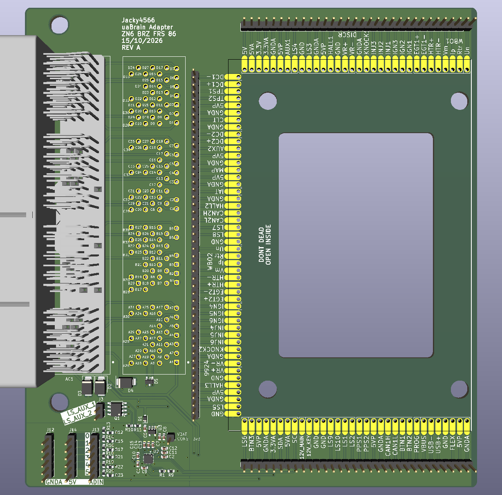

# ZN6 uaEFI Adapter

A DIY adapter board that plugs the [rusEFI](https://rusefi.com) **uaBrain** into the factory ECU connector of the **ZN6 platform** (Toyota 86 / Scion FR-S / Subaru BRZ, 2012–2020).

## What it does

The board has the same 135-pin ECU header as the factory ECU, so it plugs straight into the car's harness. Every ECU pin is mirrored to a labelled solder-pad field, You connect the two with jumper wires.

That means you can wire up **any engine swap** on the factory body harness. You aren't locked into the FA20 pinout: route each harness pin to whatever uaEFI function your engine needs.

My own build is an **EZ36** (Subaru 3.6 L H6) swap. The pin plan for it is in the `H6 Tribeca` sheet of [`Wiring.xlsx`](Wiring.xlsx).

> **Status: REV A, untested.** Check the pinout against your own harness before powering anything.

### ECU pin numbering

The factory ECU uses four connectors, which the TE 6376430-2 combines into one 135-position header. The pad numbers in the schematic map to the factory connector pins like this:

| Factory connector | Pins | Pad numbers |
|---|---|---|
| A (A33) | A1–A31 | 1–31 |
| B (A34) | B1–B35 | 32–66 |
| C (A35) | C1–C35 | 67–101 |
| D (A36) | D1–D34 | 102–135 |

For example, `B28` is pad 31 + 28 = **59**. The factory function of every pin is in the `BRZ FRS Pinout 2018` sheet of [`Wiring.xlsx`](Wiring.xlsx).

## Fixed pins

The following pins are expected

### ECU side (AC1 / AC2)

| ECU pin | Pad | Factory function | Board net | Goes to |
|---|---|---|---|---|
| A4 | 4 | EC (ECU ground) | `GND` | Ground |
| A18 | 18 | CAN Lo | `CAN1-` | uaBrain N6 (CAN1 L), ESD D5 |
| A19 | 19 | CAN Hi | `CAN1+` | uaBrain N5 (CAN1 H), ESD D5 |
| A28 | 28 | Sensor ground (shield) | `GND` | Ground |
| B1 | 32 | Power ground | `GND` | Ground |
| B2 | 33 | Power ground | `GND` | Ground |
| B3 | 34 | Power ground | `GND` | Ground |
| B29 | 60 | Sensor ground (shield) | `GND` | Ground |
| B30 | 61 | Shield | `GND` | Ground |
| B35 | 66 | Sensor ground (shield) | `GND` | Ground |
| D3 | 104 | Power ground | `GND` | Ground |
| D4 | 105 | Power ground | `GND` | Ground |

The factory CAN bus on A18/A19 should be wired to the uaEFI **CAN** (the "CAN2" in Toyota's naming).

## References

- [FT86Club ECU pinout thread](https://www.ft86club.com/forums/showthread.php?t=143079)
- [TE 6376430-2 connector](https://www.digikey.com/en/products/detail/te-connectivity-amp-connectors/6376430-2/18111199)

## License

[MIT](LICENSE) © 2026 Jacky4566 
