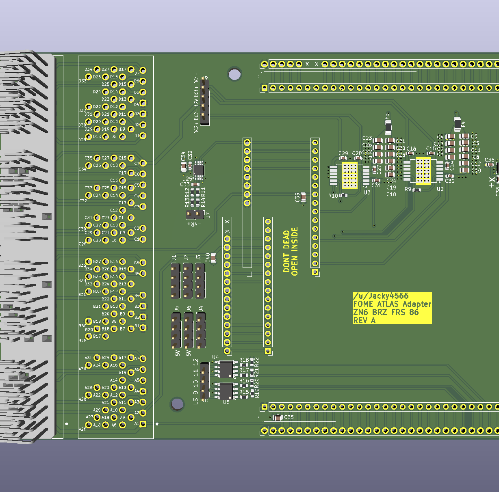

# ZN6 ATLAS Adapter

A DIY adapter board that plugs the [FOME-tech](https://www.fome.tech) **ATLAS** ECU into the factory ECU connector of the **ZN6 platform** (Toyota 86 / Scion FR-S / Subaru BRZ, 2012–2020).

## What it does

The board has the same 135-pin ECU header as the factory ECU, so it plugs straight into the car's harness. Every ECU pin is mirrored to a labelled solder-pad field, and you connect the two with jumper wires.

That means you can wire up **any engine swap** on the factory body harness. You aren't locked into the FA20 pinout: route each harness pin to whatever ATLAS function your engine needs.

My own build is an **EZ36** (Subaru 3.6 L H6) swap. The pin plan for it is in the `H6 Tribeca` sheet of [`Wiring.xlsx`](Wiring.xlsx).

> **Status: REV A, untested.** Check the pinout against your own harness before powering anything.

## On-board extras

On top of the pass-through wiring, the adapter adds:

| Function | Part | Notes |
|---|---|---|
| Electronic throttle (ETB) | 2× Infineon TLE9201SG H-bridge | Two DC motor drivers (`DC Driver 1` / `DC Driver 2` sheets), controlled by `DCx_PWM`, `DCx_DIR` and `DCx_DIS`. Outputs on `OUT_DC1±` / `OUT_DC2±`. One drives the ETB, the second is free for another throttle, idle valve or wastegate. |
| VR conditioner | Maxim MAX9924 | Variable-reluctance crank/cam input (`VR1`) conditioned to a logic-level signal for the ATLAS. |
| IMU | ST LSM6DSV | 6-axis accelerometer + gyro on SPI (`SPI_SCK`, `SPI_MOSI`, `SPI_MISO`, `SPI_CS`, 3.3 V). |
| 4× low-side outputs | 2× ST VNLD5090 (dual) | Protected low-side switches on `LS9`–`LS12`, 3.5 A max, solenoid-load capable. |

Power is distributed on `12V_Constant`, `12V_SW` (key-on) and `12V_MR` (main relay), with fused feeds to the add-on circuits.

### ECU pin numbering

The factory ECU uses four connectors, which the TE 6376430-2 combines into one 135-position header. The pad numbers in the schematic map to the factory connector pins like this:

| Factory connector | Pins | Pad numbers |
|---|---|---|
| A (A33) | A1–A31 | 1–31 |
| B (A34) | B1–B35 | 32–66 |
| C (A35) | C1–C35 | 67–101 |
| D (A36) | D1–D34 | 102–135 |

For example, `B28` is pad 31 + 28 = **59**. The factory function of every pin is in the `BRZ FRS Pinout 2018` sheet of [`Wiring.xlsx`](Wiring.xlsx).

## Fixed pins

The following pins are hard-wired on the board.

### ECU side (AC1 / AC2)

| ECU pin | Pad | Factory function | Board net | Goes to |
|---|---|---|---|---|
| A4 | 4 | EC (ECU ground) | `GND` | Ground |
| A18 | 18 | CAN Lo | `CAN1-` | ATLAS CAN1 L |
| A19 | 19 | CAN Hi | `CAN1+` | ATLAS CAN1 H |
| A28 | 28 | Sensor ground (shield) | `GND` | Ground |
| B1 | 32 | Power ground | `GND` | Ground |
| B2 | 33 | Power ground | `GND` | Ground |
| B3 | 34 | Power ground | `GND` | Ground |
| B29 | 60 | Sensor ground (shield) | `GND` | Ground |
| B30 | 61 | Shield | `GND` | Ground |
| B35 | 66 | Sensor ground (shield) | `GND` | Ground |
| D3 | 104 | Power ground | `GND` | Ground |
| D4 | 105 | Power ground | `GND` | Ground |

The factory CAN bus on A18/A19 (the "CAN2" in Toyota's naming) is wired to the ATLAS CAN1.

## Revisions
REV A
- I assume this board is perfect and will never need updating....Hopefully..

## Libraries

The ATLAS module footprint and symbols come from the [FOME libraries](FOME-libraries-main/) (`fome_modules`). Project-specific symbols and footprints are in `ZN6_Adapter.kicad_sym` and `ZN6.pretty`.

## References

- [FT86Club ECU pinout thread](https://www.ft86club.com/forums/showthread.php?t=143079)
- [TE 6376430-2 connector](https://www.digikey.com/en/products/detail/te-connectivity-amp-connectors/6376430-2/18111199)
- [TLE9201SG](https://www.infineon.com/cms/en/product/power/motor-control-ics/brushed-dc-motor-driver-ics/single-half-bridge-full-bridge-motor-driver-ics/tle9201sg/), [MAX9924](https://www.analog.com/en/products/max9924.html), [LSM6DSV](https://www.st.com/en/mems-and-sensors/lsm6dsv.html), [VNLD5090](https://www.st.com/en/automotive-analog-and-power/vnld5090-e.html)

## License

[MIT](LICENSE) © 2026 Jacky4566
